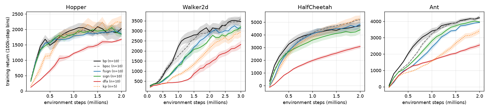

# Local credit assignment in streaming actor-critic

Code and result summaries for a comparison of local learning rules for the hidden layers of a streaming
actor-critic agent on four MuJoCo locomotion tasks. The agent is stream AC(λ) as in the 2026 version of Elsayed,
Lupu, Vasan and Mahmood (arXiv:2410.14606v3; code: github.com/mohmdelsayed/streaming-drl, branch `2026`): batch size 1,
no replay buffer, no target networks, one update per environment step.

## Question

A streaming learner updates its networks from one transition at a time. Its hidden layers are normally trained with
backprop, which sends the output error back through the transposes of the forward weights. How much final return is
lost when the hidden layers instead learn from feedback that does not carry the forward weights' magnitudes? And can
the agreement between such local updates and the exact ones be predicted?

## Rules

| rule | error sent to the hidden layers | notes |
|---|---|---|
| `bp` | through W<sup>T</sup> (exact backprop) | reference |
| `bpsc` | through W<sup>T</sup> | W2, W3 held to a fixed sign pattern S; control for `fsign` |
| `fsign` | through S<sup>T</sup> | fixed-sign variant of `sign`; W2, W3 held to S |
| `sign` | through sign(W)<sup>T</sup> of the current weights | sign-concordant feedback (Liao, Leibo and Poggio, 2016); signs not fixed |
| `dfa` | B<sub>l</sub> g<sub>out</sub>, fixed random B<sub>l</sub> | direct feedback alignment (Nøkland, 2016); feedback alignment is Lillicrap et al. (2016) |
| `kp` | through K | Kolen-Pollack update without weight decay: K receives the same changes as W (Kolen and Pollack, 1994; Akrout et al., 2019). Without decay, K − W stays at its random initial value, so K does not converge to W. The decay of 1e-5 in the pre-registered test failed and was replaced by 0 after that result. |
| `frozen` | none | hidden layers stay at their initial values |

Actor and critic each have two hidden layers of 128 units (Linear, LayerNorm without gain or bias, leaky ReLU) and a
linear readout, sparse initialisation (95 % of weights zero) and the per-synapse normalised step of the 2026 stream
AC(λ) code (update lr·δ·e/m, where m is a decaying running maximum of |e·δ|; the 2024 version used ObGD, one global
step-size bound). All rules use the same hyperparameters (`slc/train.py` defaults: learning rates 1e-4 for the policy
and 2e-4 for the value, λ = 0.8, γ = 0.99, β = 0.99995 for the running maximum, entropy coefficient 0.01). The readout weights always receive their exact gradient. S is
fixed at initialisation from the signs of the initial weights (random where an initial weight is zero); the input
layer W1 is not sign-constrained, and a weight that would cross zero against its sign stops at zero. `fsign` does not
read weight magnitudes, but it is not strictly local: its feedback signs match the forward signs from the start, and
like `bp`, `bpsc`, `sign` and `kp` it uses the full LayerNorm backward, which needs layer-wide means of the errors.
`dfa` uses the diagonal LayerNorm backward. The rules themselves are known (Kolen and Pollack, 1994; Liao et al., 2016;
Lillicrap et al., 2016; Nøkland, 2016; Moskovitz et al., 2018; Xiao et al., 2018); what is studied here is their
behaviour in the streaming regime.

## Layout

```
slc/network.py              networks, rules (hand-written backward pass), streaming optimiser
slc/train.py                training script (one batch of agents = rules x seeds)
tests/test_backward.py      backward pass and one learner step against jax.grad
analysis/extract.py         training logs -> results/final_returns.csv, results/curves.csv
analysis/table.py           main table, pooled ratios, Hopper sensitivity, frozen control
analysis/plot_curves.py     results/figures/learning_curves.png
analysis/arcsine_check.py   sign agreement of fsign and backprop updates against the arcsine law
reproduce.sh                every training run behind the results, grouped by task
results/                    per-seed final returns, binned learning curves, table output, figure,
                            per-seed output of the Humanoid check
```

## Setup

Python 3.12, CPU only.

```
python -m venv .venv
source .venv/bin/activate          # Windows: .venv\Scripts\activate
pip install -r requirements.txt
```

## Smoke test (about two minutes on a CPU)

```
python -m tests.test_backward
python -m slc.train --env Hopper-v5 --rules bp,fsign,dfa --n_seeds 1 --steps 3000 --log_every 1000 --shadow --out runs_smoke --tag smoke
python analysis/arcsine_check.py runs_smoke/Hopper-v5_smoke.json --min_states 500
python analysis/table.py
```

The first command should end with `ALL PASS`. The last one recomputes the results table below from
`results/final_returns.csv`.

## Results

Final return is the mean return of the last 100 training episodes at the end of training (2M environment steps;
Walker2d 3M). Each entry is the ratio of mean final returns to `bp` on the same task, with a 95 % percentile
bootstrap interval (seeds resampled within each rule, 20,000 resamples; the second decimal of an interval bound can
move by 0.01 with the bootstrap seed). n is the number of seeds.

| task | `bp` return | `bpsc` | `fsign` | `sign` | `dfa` | `kp` | `fsign` / `bpsc` |
|---|---|---|---|---|---|---|---|
| Hopper | 2061 (n=10) | 0.98 [0.80, 1.31] | 0.89 [0.72, 1.18] | 0.89 [0.71, 1.18] | 0.81 [0.66, 1.07] | 1.08 [0.83, 1.49] (n=5) | 0.90 [0.78, 1.03] |
| Walker2d | 3437 (n=10) | 1.05 [0.91, 1.23] | 0.91 [0.79, 1.06] | 0.93 [0.81, 1.09] | 0.67 [0.55, 0.81] | 0.86 [0.69, 1.06] | 0.87 [0.77, 0.97] |
| HalfCheetah | 4717 (n=10) | 1.10 [0.96, 1.28] | 1.03 [0.88, 1.21] | 0.93 [0.79, 1.12] | 0.65 [0.56, 0.77] | 1.11 [0.94, 1.32] | 0.93 [0.84, 1.05] |
| Ant | 4207 (n=10) | 1.02 [0.98, 1.06] | 0.94 [0.90, 0.98] | 0.94 [0.90, 0.99] | 0.61 [0.55, 0.67] | 0.82 [0.74, 0.89] | 0.92 [0.89, 0.96] |

All cells have 10 seeds except `kp` on Hopper (5). Pooled over the four tasks (each seed divided by its task's mean
`bp` return; seeds resampled within task):

- `fsign` / `bp`: 0.94 [0.87, 1.03]. The interval includes 1 only because of one collapsed `bp` seed on Hopper (see
  Limitations); without it the pooled ratio is 0.92 [0.86, 0.99]. Fixed-sign feedback costs about 8 % of final
  return against `bp` without that seed and about 9 % against `bpsc` (next line).
- `fsign` / `bpsc`: 0.91 [0.86, 0.96], against exact gradients on the same sign-constrained network; per task the
  interval excludes 1 only on Walker2d and Ant.
- `bpsc` / `bp`: 1.04 [0.96, 1.13] (1.01 [0.95, 1.09] without the collapsed Hopper seed). No cost of the sign
  constraint itself is detected.

Direct feedback alignment reaches 0.61 to 0.81 of `bp`. In a separate 3-seed run at 2M steps, frozen hidden layers
reach 0.12 to 0.39 of `bp` (Hopper 0.39 [0.21, 0.67], Walker2d 0.12, HalfCheetah 0.20, Ant 0.21), so the hidden-layer
learning accounts for most of the return. `results/table.txt` also gives the table for the episodes that end in the
last 100k steps; the conclusions do not change.



Training return in 100k-step bins, mean over seeds with ±1 standard error; 10 seeds per curve except `kp` on Hopper
(5). `fsign` learns more slowly than `bp` on Walker2d and Ant before it approaches it. `dfa` and `kp` are still rising at
the end of training on every task, as are several Walker2d curves, so their final ratios depend on the training
budget; the ratios above describe the end of training only.

### Sign agreement on Humanoid

For hidden unit i of the actor's last hidden layer, the exact error is w<sub>i</sub>·g and the `fsign` error is
s<sub>i</sub>·g, where g is the error at the actor outputs and w<sub>i</sub>, s<sub>i</sub> are column i of the readout
W3 and of its sign pattern S3. If g is zero-mean Gaussian with second moment Σ, the two errors agree in sign with
probability ½ + arcsin(ρ<sub>i</sub>)/π, where ρ<sub>i</sub> = w<sub>i</sub>ᵀΣs<sub>i</sub> /
√(w<sub>i</sub>ᵀΣw<sub>i</sub> · s<sub>i</sub>ᵀΣs<sub>i</sub>) (Sheppard, 1899). Since a synapse's gradient is its unit's
error times its input, this is also the fraction of synapses whose per-step gradient signs agree (before the eligibility
trace and the optimiser's normalisation). The form of the check (actor,
last hidden layer, Σ from sampled policy errors, before LayerNorm), the pass and fail rules and two rival predictions
(0.630, the value at initialisation; 0.55 to 0.62, a linear trend in action dimension) were fixed on Hopper,
Walker2d and Ant before Humanoid (17 action dimensions) was run.

On Humanoid (3 `fsign` seeds at 500k steps, at least 10,000 states per seed) the law gives 0.692 and the measured
agreement before LayerNorm is 0.695; the per-unit correlation between law and measurement is 0.98. After the full
LayerNorm backward the mean agreement is 0.03 above the law, and the per-unit correlation falls to 0.23. The
agreement of the applied updates (after traces and normalisation), logged during training with `--shadow`, is 0.714.
This concerns the agreement of updates, not returns. No Humanoid return is reported: the run trained only `fsign`,
`sign` and `dfa` for 500k steps, without a `bp` reference, because it was made for this check.

The per-seed output is in `results/Humanoid-v5_humT5_alaw.json`. It was written by the original version of
`analysis/arcsine_check.py` and uses that script's field names (`sig_law` for the law, `logged_ucos10` for the logged
agreement, plus a 3-episode reading `three_ep` and `nz_over_time`, which the current script no longer computes). Its
verdict label refers to the pass rule fixed for Humanoid.

## Reproducing the numbers

Every number in the table comes from `python analysis/table.py` on `results/final_returns.csv`; its output is saved in
`results/table.txt`. To regenerate the CSV from new training runs:

| numbers | training | analysis |
|---|---|---|
| Hopper row, Hopper without seed 9 | `bash reproduce.sh hopper` | `python analysis/extract.py --log_dir runs --out runs/summary` then `python analysis/table.py --csv runs/summary/final_returns.csv` |
| Walker2d row | `bash reproduce.sh walker2d` | as above |
| HalfCheetah row | `bash reproduce.sh halfcheetah` | as above |
| Ant row | `bash reproduce.sh ant` | as above |
| pooled ratios (with and without Hopper `bp` seed 9) | all four tasks | as above |
| frozen control | `bash reproduce.sh frozen` | as above |
| learning-curve figure | all four tasks | `python analysis/plot_curves.py --csv runs/summary/curves.csv --out runs/summary/curves.png` |
| Humanoid sign agreement | `bash reproduce.sh humanoid` | `python analysis/arcsine_check.py runs/Humanoid-v5_humT5.json` |

A training run trains all its agents in one batch on the CPU. On machine A (below), shared with other jobs, the
15-agent runs advanced at about 50 steps per second, so a 2M-step run took about 11 hours and a 3M-step run about
17 hours. The runs are independent and can run in parallel.

**Bitwise reproduction.** An agent's action noise comes from a key that depends on `--seed0` and on the agent's
position in the batch, and XLA can round differently for different batch shapes, so `reproduce.sh` keeps the original
rules, seeds and batch sizes of every run. A rounding difference in the last bit grows within a few hundred steps, as
in any chaotic simulation; such runs agree in distribution, not bit for bit. Two machines produced the reported runs:
machine A, a laptop (JAX 0.7.2, MuJoCo 3.3.7, Gymnasium 1.2.1; the versions in `requirements.txt`), and machine B, a
desktop (JAX 0.11.2, MuJoCo 3.15.0, Gymnasium 1.1.1). The `machine` column of `results/final_returns.csv` records
which. Runs repeat bit for bit only on the same software versions: with `requirements.txt` on machine A,
`slc/train.py` reproduces the start of the machine-A logs exactly (checked over the first 5,000 steps of the Hopper and
Walker2d runs). Some `bp`, `bpsc` and `fsign` runs were made with an earlier initialisation that did not draw the
Kolen-Pollack matrices K; this changes only the random signs that S assigns to the zero-initialised entries of W3.
`--legacy_init` repeats it. For Hopper and Walker2d (all seeds) this was checked directly on machine A; for
HalfCheetah seeds 0-4 and Ant seeds 0-2 it rests on an earlier replay on machine B; the other machine-B runs are
taken to use the current initialisation, which was checked on machine B for HalfCheetah seeds 5-9 but not for Ant
seeds 6-9. The `code` column of `results/final_returns.csv` records the assignment, and `reproduce.sh` follows it. The frozen
control comes from an earlier version of the training script that also trained feedback alignment and drew action
noise differently, so `reproduce.sh frozen` repeats the experiment but not its random streams. A run resumed from a
checkpoint (`--resume`) restarts its episodes from new environment seeds and is not bitwise identical to an
uninterrupted one.

## Limitations

- One benchmark family: four MuJoCo locomotion tasks, one network size and one set of hyperparameters, which were
  the defaults of stream AC(λ) with backprop. All rules share those learning rates. In a small per-rule learning-rate
  sweep (0.5x, 1x, 2x; Hopper and Walker2d at 2M steps, 3 seeds; logs not included), each rule at its own best
  learning rate gave `fsign` 0.73 (Hopper) and 0.79 (Walker2d) of `bp` at its best, a larger gap than in the table.
  With 3 seeds these ratios are noisy.
- All results use the per-synapse normalised optimiser above. Because each synapse's update is divided by its own
  running maximum, a positive per-unit scale on the feedback cancels and mainly the sign of the error matters, which
  is close to the sign-based updates Liao et al. (2016) found necessary for asymmetric feedback. A short test with the
  ObGD optimiser of the 2024 version (Hopper, 3 seeds, 1M steps; not included) suggested that the local rules lose
  more without per-synapse normalisation, but that test was confounded by the scale of the feedback. The results
  should not be assumed to hold for other optimisers.
- Ten seeds per cell leave wide per-task intervals on Hopper, Walker2d and HalfCheetah (0.27 to 0.46 wide for
  `fsign` / `bp`).
- Hopper depends on one collapsed `bp` seed (seed 9, final return 217 against 1525 to 2999 for the other seeds). With
  it the ratio is 0.89; without it, 0.81 [0.69, 0.95] (0.79 if seed 9 is also dropped from `fsign`; 0.82 to 0.83 on the
  last-100k-steps window). The same seed decides whether the pooled `fsign` / `bp` interval includes 1 (0.94
  [0.87, 1.03] with it, 0.92 [0.86, 0.99] without).
- On Hopper and Walker2d the `bp`, `bpsc` and `fsign` runs ran on machine A and the `dfa`, `sign` and `kp` runs on
  machine B (except Walker2d `kp` seeds 0-4, machine A), so those columns compare across machines. HalfCheetah and
  Ant ran on machine B only.
- The ratios describe final return only; `fsign` learns more slowly on Walker2d and Ant.
- The Humanoid check concerns the agreement of updates, not returns, and covers only the actor's last hidden layer of
  three `fsign` agents at 500k steps. The arcsine law is exact only for Gaussian errors; the new content is the
  per-unit fit on real policy errors. After the full LayerNorm backward the per-unit fit is poor (r = 0.23).
- `fsign` is free of weight-magnitude transport but not strictly local (see Rules), and its feedback signs are matched
  to the forward signs at initialisation.
- The frozen control has 3 seeds and comes from a separate run.

## References

- Akrout, Wilson, Humphreys, Lillicrap and Tweed (2019). Deep learning without weight transport. NeurIPS.
  arXiv:1904.05391.
- Elsayed, Lupu, Vasan and Mahmood (2026). Streaming deep reinforcement learning finally works. arXiv:2410.14606v3.
  Code: https://github.com/mohmdelsayed/streaming-drl, branch `2026`.
- Kolen and Pollack (1994). Backpropagation without weight transport. Proceedings of the IEEE International
  Conference on Neural Networks, vol. 3, 1375-1380. doi:10.1109/ICNN.1994.374486.
- Liao, Leibo and Poggio (2016). How important is weight symmetry in backpropagation? AAAI. arXiv:1510.05067,
  doi:10.1609/aaai.v30i1.10279.
- Lillicrap, Cownden, Tweed and Akerman (2016). Random synaptic feedback weights support error backpropagation for
  deep learning. Nature Communications 7, 13276.
- Moskovitz, Litwin-Kumar and Abbott (2018). Feedback alignment in deep convolutional networks. arXiv:1812.06488.
- Nøkland (2016). Direct feedback alignment provides learning in deep neural networks. NIPS 29. arXiv:1609.01596.
- Sheppard (1899). On the application of the theory of error to cases of normal distribution and normal correlation.
  Philosophical Transactions of the Royal Society A 192, 101-167.
- Xiao, Chen, Liao and Poggio (2018). Biologically-plausible learning algorithms can scale to large datasets.
  arXiv:1811.03567.

## License

MIT, see `LICENSE`.
